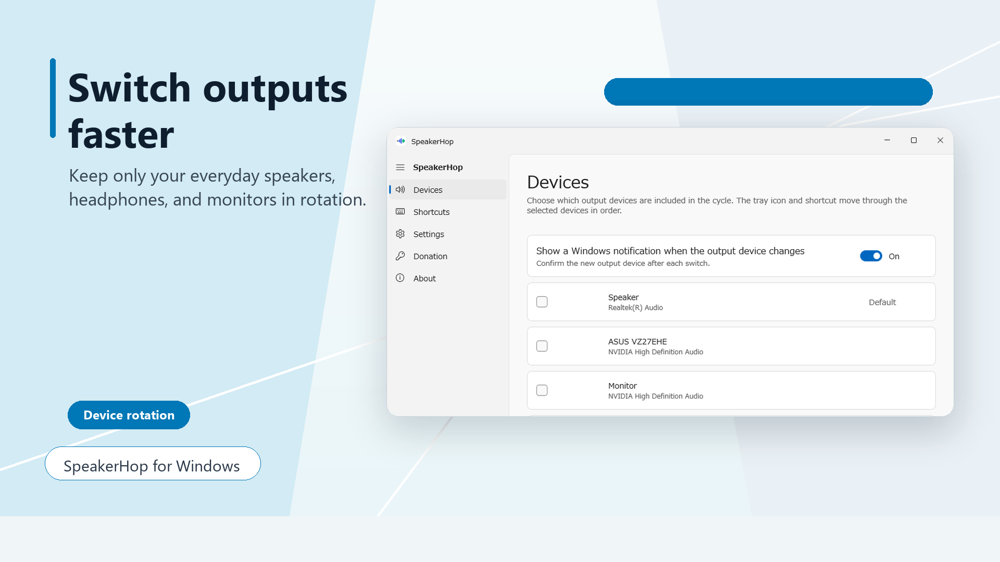

# SpeakerHop

**Version 1.1.0** (app/MSIX: `1.1.0.0`)

[Release preparation](docs/releases/1.1.0.md) · [Changelog](CHANGELOG.md) · [Installation guide](docs/releases/INSTALL.md)

WinUI 3 desktop app for switching the Windows default audio output device from the tray icon or global shortcuts.



SpeakerHop is a small Windows tray utility for people who frequently move audio between speakers, headphones, monitors, TVs, and virtual devices. Choose the output devices that should be part of the cycle, then switch between them from the tray icon or a global shortcut without opening Windows settings.

The image above shows the English Devices page in SpeakerHop 1.1.0. The Devices page lets you select which active render endpoints are included in the switching cycle. Disconnected or unused outputs can stay out of the rotation, while notifications confirm each successful switch.

## Features

- Left-navigation WinUI 3 settings window.
- Tray icon left-click cycles through selected output devices.
- Device settings page controls which render endpoints are included in the cycle.
- Global shortcuts can cycle, switch to a fixed device, change volume, toggle mute for the current default output device, or toggle mute for the Windows default capture endpoint.
- The shortcut editor lists every action with its key binding, enabled state, and relevant target or volume-step setting. Unassigned actions remain visible, and each action supports multiple bindings.

- Compact, aligned settings rows make device, shortcut, and settings pages easier to scan; the active output device is highlighted.
- Output mute and microphone mute are separate shortcut actions. Microphone mute targets the default capture endpoint for the Multimedia role; neither action is assigned a shortcut automatically.
- Settings changes are saved atomically. Shortcut edits are staged until saved, and failed persistence or hotkey registration is reported without silently discarding the existing configuration.
- Legal documents follow the selected language: Japanese, English, Simplified Chinese, Traditional Chinese, Korean, German, French, or Spanish. Changing language requires confirmation.
- MSIX manifest and packaging script are included for Microsoft Store preparation.

## Default shortcuts

| Action | Shortcut |
| --- | --- |
| Cycle output device | Ctrl + Alt + Shift + F9 |
| Volume down | Ctrl + Alt + Shift + F10 |
| Volume up | Ctrl + Alt + Shift + F11 |

These defaults apply to new settings. Updates preserve saved shortcuts; all bindings can be changed on the Shortcuts page. Other actions are initially unassigned.

## Build

Use Visual Studio Build Tools MSBuild. `dotnet build` may fail on machines where the .NET SDK cannot find Appx/Pri packaging tasks. The app targets .NET 8 and publishes self-contained, so the target PC does not need a separately installed .NET runtime.

```powershell
& 'C:\Program Files (x86)\Microsoft Visual Studio\2022\BuildTools\MSBuild\Current\Bin\MSBuild.exe' src\SpeakerHop\SpeakerHop.csproj /restore /p:Configuration=Release /p:Platform=x64 /m
```

## Create unsigned, self-contained MSIX

```powershell
.\build-package.ps1 -Version 1.1.0.0 -Publisher 'CN=Your Partner Center Publisher'
```

The script runs a clean self-contained .NET publish into `artifacts\publish-<version>`, validates that the .NET runtime and requested app version are present, copies only that publish output into a clean package layout, and excludes PDB files. Windows App Runtime 1.7 is a package dependency. `src\SpeakerHop\Package.appxmanifest` is the manifest template; package identity, version, architecture, publisher, and executable entry point are safely replaced for the requested package.

The unsigned package is written to `artifacts\SpeakerHop_<version>_x64.msix`. For Store submission, pass the Partner Center reserved identity and publisher values, add final brand assets/screenshots, sign or let Partner Center sign as appropriate, and run Windows App Certification Kit.

## Local release installation

Release assets include a development ZIP and an unsigned MSIX for signing or Store submission. The unsigned MSIX is not a directly installable, trusted production installer. See [GitHub releases](https://github.com/mmiyaji/SpeakerHop/releases) for published downloads. Microsoft Store submission and availability are tracked separately in the [Store submission notes](docs/releases/store-1.1.0.md).

For the development ZIP, enable Windows Developer Mode and install Windows App Runtime 1.7 (x64). Extract the ZIP and run:

```powershell
.\install-local.ps1
```

The installer copies the package to a stable folder under LocalAppData, registers it without removing settings, and launches it. If package registration is unavailable under your user profile, choose a writable local folder outside the checkout (replace this example with your chosen location):

```powershell
.\install-local.ps1 -InstallDirectory D:\Apps\SpeakerHop\1.1.0.0
```

Do not move or delete the installed folder. The app shows its main window on the first launch; subsequent launches respect **Show main window on startup**. When that setting is off, open settings from the tray icon's context menu.

Updates are staged and validated before the running app is stopped. An existing install folder is preserved; the installer selects a fresh sibling folder when the requested destination already exists. If registration fails, it attempts to restore the previous registration and restart the previous app. Any folder still used by a package registration is retained.

The app uses desktop CoreAudio APIs and the commonly used PolicyConfig COM interface to change the default output. Windows does not expose a public WinRT API for this operation, so the packaged desktop app requires full trust (`runFullTrust`). A global shortcut may fail to register if another app already owns it; error `1409` indicates that conflict, and another shortcut can be assigned in Settings. Current builds share a single-instance guard across package identities. Exit any older test builds before updating.

To run the unit tests and the installer transaction tests (the latter uses mocks and does not alter the installed app):

```powershell
dotnet test tests\SpeakerHop.Tests\SpeakerHop.Tests.csproj
.\tests\install-local.transaction.tests.ps1
```

## Store review note

Windows does not expose a public WinRT API for setting the default render endpoint. This app uses the desktop CoreAudio endpoint APIs plus the commonly used PolicyConfig COM interface, and therefore ships as a full-trust packaged desktop app with `runFullTrust`. Keep this explicit in the Store submission notes.

## Copyright, terms and privacy

Copyright © 2026 mmiyaji. All rights reserved. No open-source redistribution or modification license is granted for SpeakerHop itself. Third-party components retain their own licenses.

The Information tab includes offline-readable [copyright](src/SpeakerHop/Legal/Copyright.txt), [terms of use](src/SpeakerHop/Legal/Terms.txt), [privacy policy](src/SpeakerHop/Legal/Privacy.txt), and [third-party notices](src/SpeakerHop/Legal/ThirdPartyNotices.txt), along with support, releases and the settings location. The app does not record audio or automatically upload logs. Opening the Donation tab fetches an external button image; external links open the corresponding service in your browser.

Legal documents follow the selected application language (Japanese, English, Simplified Chinese, Traditional Chinese, Korean, German, French, or Spanish). Third-party license originals remain unchanged and can be selected separately from the translated index.

## Product website

The static Japanese/English product website is in [site/](site/README.md). Run `python -m http.server 8080 --directory site` to preview it locally.
