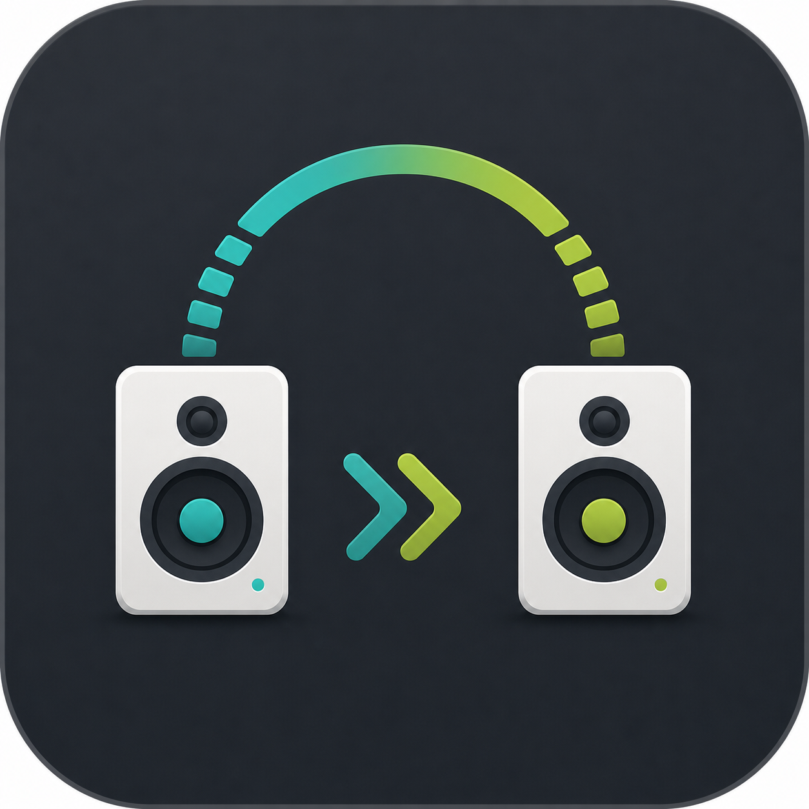
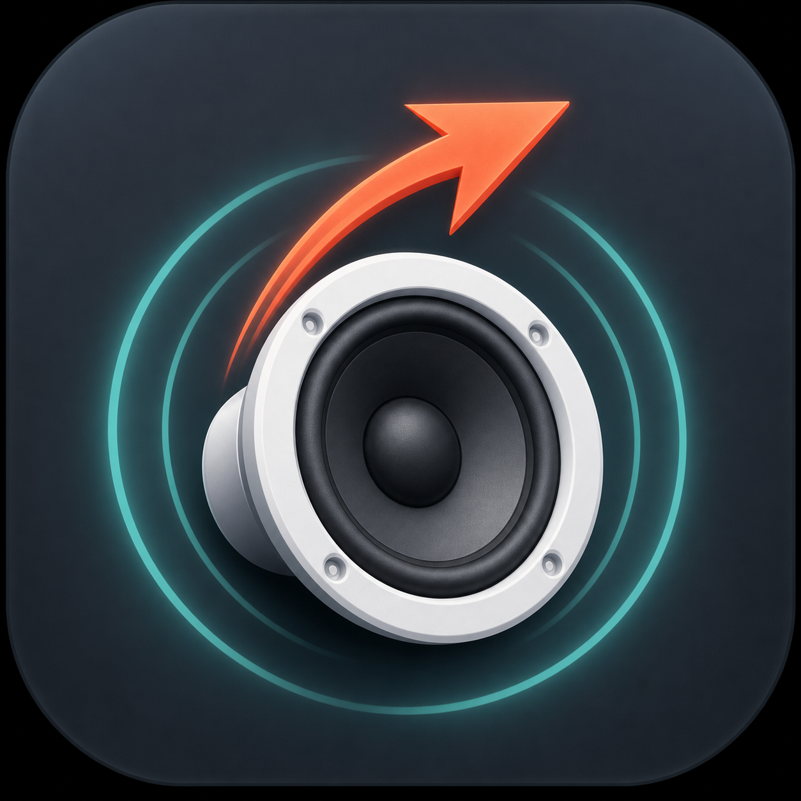

# SpeakerHop Icon Concepts

Generated with the built-in ImageGen workflow for app icon exploration.

| Concept | Preview | Direction |
| --- | --- | --- |
| A |  | Speaker cone with circular switch arrows. Strongest direct match for audio output switching. |
| B |  | Two speaker devices with a hop arc. Most explicit about switching between endpoints. |
| C |  | Speaker cone with a leaping arrow. Energetic and compact, good for small sizes. |
| D |  | Waveform transforming into an arrow. Most abstract and lightweight. |

