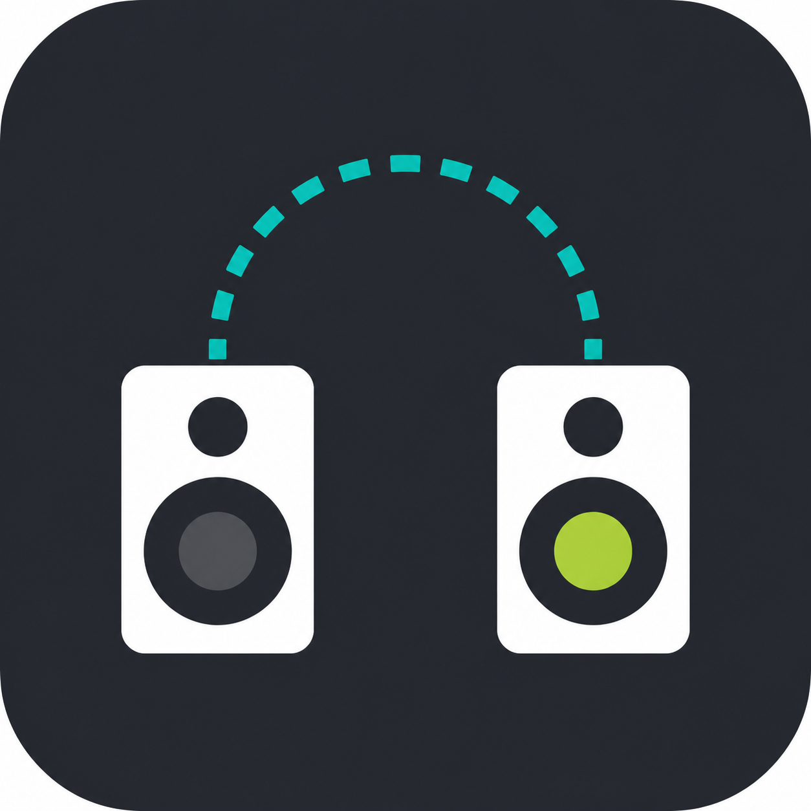

# SpeakerHop Flat Icon Concepts

Simpler flat-style ImageGen concepts for app icon refinement.

| Concept | Preview | Direction |
| --- | --- | --- |
| Flat A |  | Speaker plus circular switch arrow. Direct and recognizable. |
| Flat B |  | Two endpoints connected by a hop path. Strongest endpoint-switching metaphor. |
| Flat C |  | Abstract waveform into arrow. Cleanest flat icon candidate. |
| Flat D |  | Speaker aperture with hop arrow and endpoint. Minimal and lightweight. |

